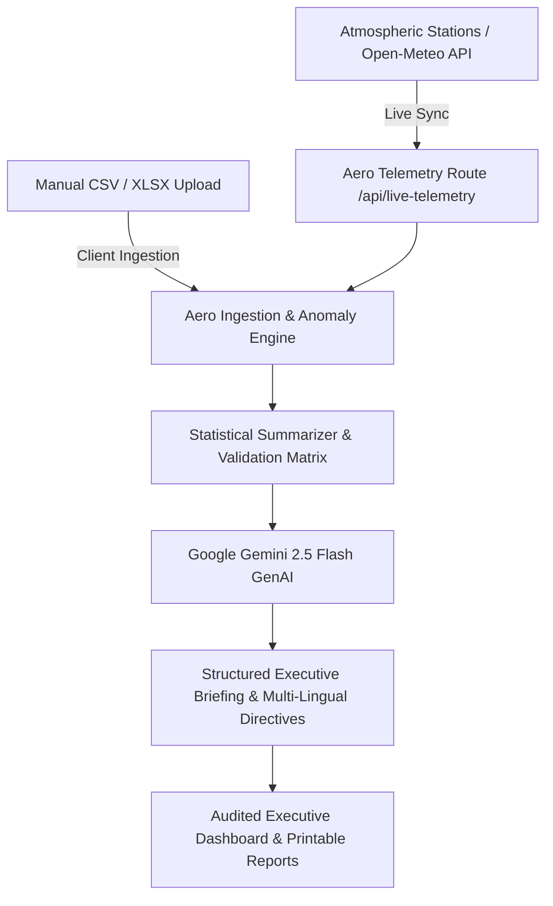

# AERO — Enterprise Civic Air Quality Intelligence Studio

A high-performance civic intelligence platform designed to convert raw atmospheric sensor telemetry into structured analysis, persona-tailored operational interventions, and multi-lingual citizen advisories for urban municipal authorities, RWAs, and educational campuses.

Built with **Next.js (App Router)**, **Tailwind CSS**, **Recharts**, and **Google Gemini GenAI**.

---

## Key Enterprise Capabilities

1. **Zero Fake/Demo Data Policy in Production**:
   - Ingests verified real-time atmospheric sensor feeds directly via Open-Meteo & Copernicus Atmospheric Monitoring.
   - Allows drag-and-drop or file upload for custom enterprise CSV and Excel (`.xlsx`) datasets.
   - If no CSV is manually uploaded, the system automatically pulls live station telemetry before synthesizing briefings.

2. **Automated Anomaly Detection & Normalization**:
   - Validates physical sensor constraints (e.g. flagging impossible states where PM2.5 > PM10).
   - Dynamic schema detection tolerant of inconsistent column naming.

3. **Multi-Lingual Citizen Dissemination**:
   - Generates dual English & Hindi advisories for general citizens and school children.
   - Formatted for WhatsApp/SMS blasts and official public notices.

4. **Multi-Persona Directives**:
   - **Municipal Ward Authority**: Water misting canons, diesel transit diversions, construction dust enforcement.
   - **Residential Welfare Associations (RWAs)**: Resident vulnerability advisories, landscape dusting controls.
   - **Educational Institutions**: Outdoor activity suspension, ventilation guidelines, bus idling management.

5. **Enterprise OAuth & Security**:
   - OAuth 2.0 endpoint integration ready for Google Identity.
   - Middleware headers for enterprise protection.

---

## Architecture Flow



---

## Environment Variables

Configure the following variables in your `.env.local` or Vercel Project Settings:

| Variable | Description | Required? |
|---|---|---|
| `GEMINI_API_KEY` | Google Gemini API Key from Google AI Studio | **Yes** (Runs fallback heuristics if omitted) |
| `GEMINI_MODEL` | Gemini Model Identifier (Default: `gemini-2.5-flash`) | Optional |
| `GOOGLE_OAUTH_CLIENT_ID` | Google OAuth 2.0 Client ID | Optional (for OAuth enforcement) |
| `GOOGLE_OAUTH_CLIENT_SECRET` | Google OAuth 2.0 Client Secret | Optional (for OAuth enforcement) |
| `ENABLE_OAUTH` | Set to `"true"` to mandate OAuth login on API endpoints | Optional |
| `AERO_ENTERPRISE_API_KEY` | Bearer token for programmatic API access | Optional |

---

## Development & Deployment

### Run Locally
```bash
npm install
npm run dev
```
Open [http://localhost:3000](http://localhost:3000).

### Deploy to Vercel
1. Push this repository to GitHub.
2. Import project into [Vercel](https://vercel.com).
3. Add `GEMINI_API_KEY` in **Environment Variables**.
4. Click **Deploy**.
